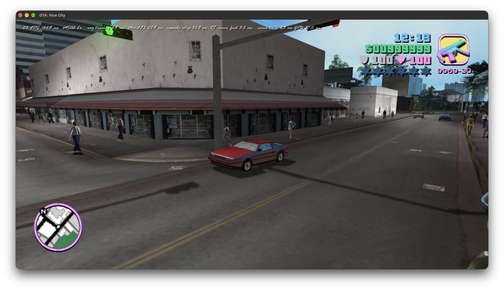
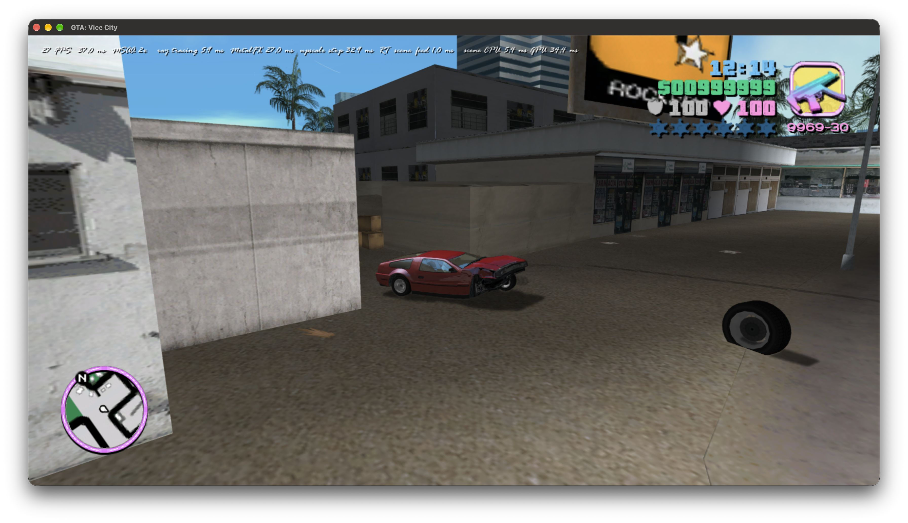
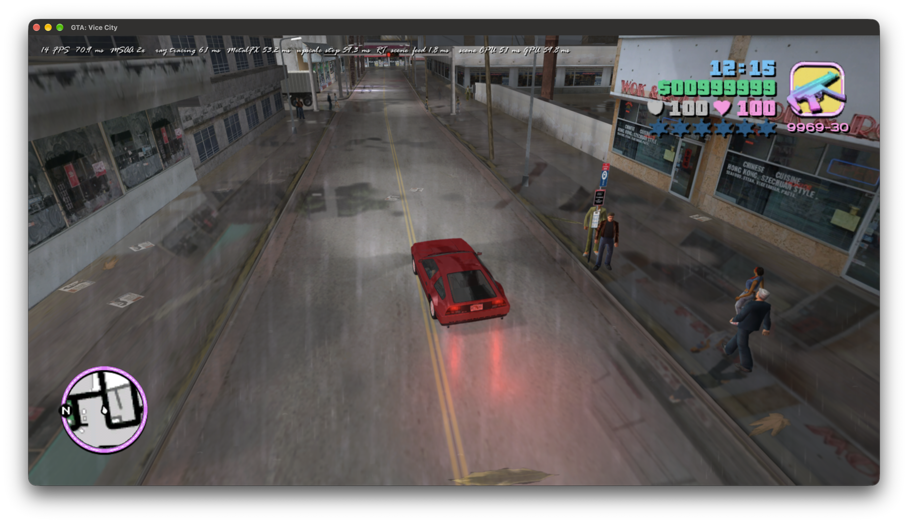
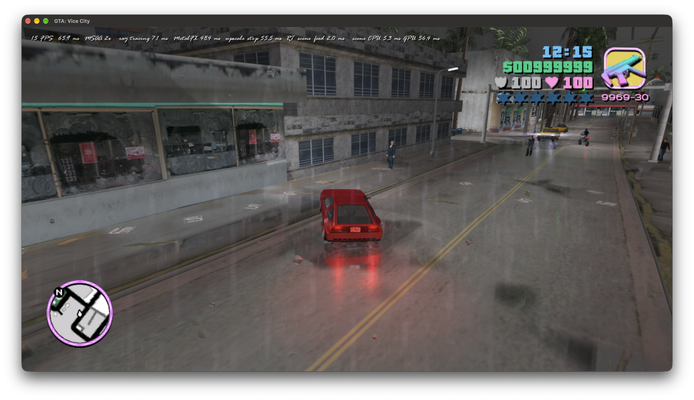
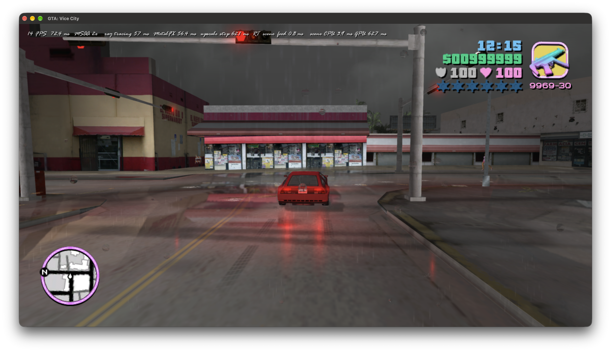
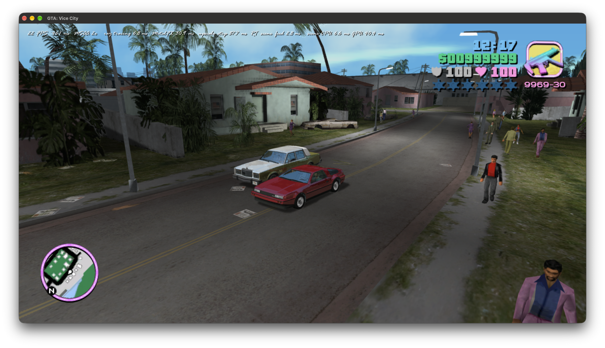

# Gameplay evidence — 18 October 2026

Six screenshots supplied by the user. These were copied from the provided attachments; the agent did not capture screens or launch/focus the game. They document unresolved visual/performance issues, not acceptance screenshots of completed fixes. The views differ and are not a controlled A/B comparison.

The first two capture the red coupe before/after a crash. The wet-road sequence shows large duplicate scene trails. The last image shows two cars with blue/opaque-looking windows. Root causes remain under investigation; screenshots alone do not identify a native model ID, isolate MetalFX cost, or prove whether a loose wheel's physics are correct.

## 02:16:09

Street view: red coupe, blue window appearance and shadows; 23 FPS shown.

## 02:16:37

Crash aftermath and detached wheel; 27 FPS shown.

## 02:17:18

Wet-road view with large repeated/ghosted scene imagery; 14 FPS shown.

## 02:17:41

Wet-road motion, duplicate scene trails and reflection instability; 15 FPS shown.

## 02:18:03

Rain/wet-road view with duplicate imagery; 14 FPS shown.

## 02:19:47

Two cars with strongly blue/opaque-looking windows; 22 FPS shown.

